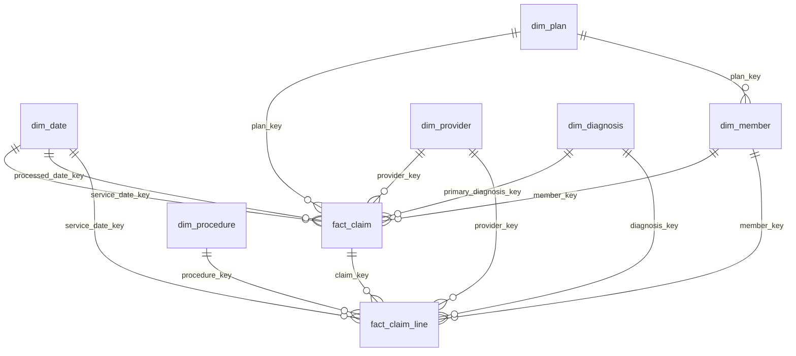
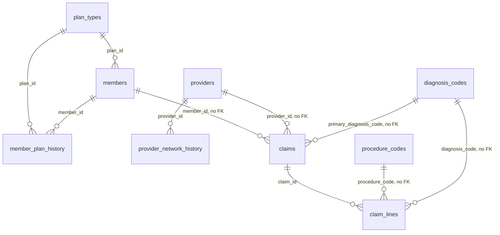

# Data model

MedInsure’s claims warehouse is a Kimball star schema in the `warehouse` schema. Facts hold the claim events. Dimensions hold the descriptive context, with Type 2 history on member and provider. The OLTP-shaped tables stay in `source`. `staging` holds the versioned history and the claim batch the load is about to accept or reject. `audit` holds watermarks and rejected claims.

Those four schemas are the load path for that star. They are not a medallion layout: there are no bronze, silver, or gold layers.

DDL for this model is in `sql/03_dimensions/` and `sql/04_facts/`.

## Grain

**fact_claim** is one row per claim header, one adjudicated encounter.

**fact_claim_line** is one row per service line within a claim.

`claim_id` is the natural key of the header. `claim_id` plus `line_number` is the natural key of the line. Both stay on the facts as degenerate dimensions. A claim number has no descriptive attributes of its own, so it does not get a dimension table.

## Fact type

Both facts are transaction facts. Each row is one event, and the money and unit measures add across rows. A periodic snapshot would be a balance at month end, and an accumulating snapshot would be milestone dates as a claim moved from submitted to paid. Denial is a status on the transaction.

`fact_claim_line` loads after `fact_claim`. Each line resolves `claim_key` from the degenerate `claim_id` on the header, and it copies that header’s `member_key` and `provider_key` so a line query uses the same SCD version as the encounter.

## Dimensions

Every dimension uses a `BIGSERIAL` surrogate key. Fact foreign keys are `BIGINT`.

| Table | SCD | Natural key | What a new version means |
|---|---|---|---|
| `dim_date` | Static | `calendar_date` | A day does not change. Loaded for 2020-01-01 through 2030-12-31 with `generate_series`. |
| `dim_member` | Type 2 | `member_id` + `effective_start` | `plan_id`, `state`, or `zip_code` changed. Name, birth date, gender, and enrollment date are copied onto each version and do not open one. |
| `dim_provider` | Type 2 | `provider_id` + `effective_start` | `network_status` or `specialty` changed. `network_effective_date` moves only when network status changes; a specialty-only change carries the previous network date forward. |
| `dim_diagnosis` | Type 1 | `diagnosis_code` | ICD-10 description or category is corrected in place. `category_code` is the three-character family. |
| `dim_procedure` | Type 1 | `procedure_code` | CPT description or category is corrected in place. |
| `dim_plan` | Type 1 | `plan_id` | Deductible, out-of-pocket maximum, coinsurance, and plan type (`HMO`, `PPO`, `EPO`, `HDHP`) belong to the plan code. A redesigned benefit is a new `plan_id`. |

`dim_member` stores `plan_id` for change detection and `plan_key` as the foreign key to `dim_plan`. `fact_claim.plan_key` comes from the member version effective on the service date.

Type 2 tables carry `effective_start`, `effective_end`, and `is_current`. The open version ends on `9999-12-31`. Ranges are inclusive. A partial unique index on the natural key `WHERE is_current` allows one current row per member and per provider.

### Conformed dimensions

`dim_date`, `dim_member`, `dim_plan`, and `dim_provider` are conformed. A future `fact_pharmacy` table uses the same member, the same calendar, the same plan, and the provider as the prescriber.

`dim_date` is role-playing. `fact_claim` references it as `service_date_key` and `processed_date_key`. The calendar table is not copied per role.

### Degenerate dimensions

- `fact_claim.claim_id`
- `fact_claim_line.claim_id`
- `fact_claim_line.line_number`

`claim_type` and `claim_status` stay on the header. They have a handful of values and the analytic queries group by them directly.

## Unknown rows

Each dimension has a Not Applicable row at surrogate key `-1`. A line whose procedure or diagnosis code is missing from the reference data keeps that `-1` key and still loads. The source procedure code is stored on the line so the quality check can see the orphan. A claim with no member or provider version does not use `-1`. It is written to `audit.etl_dead_letter` and left out of the fact.

## Relationships

`||` is exactly one. The crow's foot is zero or many. Every warehouse foreign key below is declared and `NOT NULL`.

### Warehouse star

| From | To | Column | How it is set |
|---|---|---|---|
| `dim_date` | `fact_claim` | `service_date_key` | Service-date role of the calendar |
| `dim_date` | `fact_claim` | `processed_date_key` | Processed-date role of the same calendar |
| `dim_member` | `fact_claim` | `member_key` | Version whose dates contain the service date |
| `dim_provider` | `fact_claim` | `provider_key` | Version whose dates contain the service date |
| `dim_plan` | `fact_claim` | `plan_key` | Plan on that member version |
| `dim_diagnosis` | `fact_claim` | `primary_diagnosis_key` | Header diagnosis, or key `-1` |
| `dim_plan` | `dim_member` | `plan_key` | Each member version points at one plan |
| `fact_claim` | `fact_claim_line` | `claim_key` | Line belongs to one header |
| `dim_member` | `fact_claim_line` | `member_key` | Copied from the header |
| `dim_provider` | `fact_claim_line` | `provider_key` | Copied from the header |
| `dim_date` | `fact_claim_line` | `service_date_key` | Looked up from the line's own service date |
| `dim_procedure` | `fact_claim_line` | `procedure_key` | Line procedure, or key `-1` |
| `dim_diagnosis` | `fact_claim_line` | `diagnosis_key` | Line diagnosis, or key `-1` |

### Source

DDL is in `sql/02_staging/01_source_tables.sql`. Solid relationships in the diagram are declared foreign keys. The claim member, claim provider, and the three diagnosis and procedure codes are required columns with no foreign key.

| From | To | Column | Foreign key |
|---|---|---|---|
| `plan_types` | `members` | `plan_id` | Yes |
| `plan_types` | `member_plan_history` | `plan_id` | Yes |
| `members` | `member_plan_history` | `member_id` | Yes |
| `providers` | `provider_network_history` | `provider_id` | Yes |
| `claims` | `claim_lines` | `claim_id` | Yes |
| `members` | `claims` | `member_id` | No |
| `providers` | `claims` | `provider_id` | No |
| `diagnosis_codes` | `claims` | `primary_diagnosis_code` | No |
| `procedure_codes` | `claim_lines` | `procedure_code` | No |
| `diagnosis_codes` | `claim_lines` | `diagnosis_code` | No |

## Source to warehouse map

Plans, diagnoses, procedures, and the calendar load straight into their dimensions. Member and provider history pass through the staging views, which attach the stable attributes and a version rank.

| Source | Through | Warehouse | Rule |
|---|---|---|---|
| `plan_types` | direct | `dim_plan` | Type 1 upsert on `plan_id`. `plan_key` is new. |
| `diagnosis_codes` | direct | `dim_diagnosis` | Type 1 on `diagnosis_code`. An unknown code becomes key `-1`. |
| `procedure_codes` | direct | `dim_procedure` | Type 1 on `procedure_code`. An unknown code becomes key `-1`. |
| `members` + `member_plan_history` | `staging.member_history` | `dim_member` | Type 2. A new version opens when plan, state, or zip changes. |
| `providers` + `provider_network_history` | `staging.provider_history` | `dim_provider` | Type 2. A new version opens when network status or specialty changes. |
| Calendar 2020-01-01 through 2030-12-31 | direct | `dim_date` | Static. One row per day, plus the `-1` row. |

`staging.claim_load_batch` holds the resolved header keys for one load. A row with a reject reason is written to `audit.etl_dead_letter` and left out of `fact_claim`.

| Source field | Warehouse column | Resolution |
|---|---|---|
| `claims.claim_id` | `fact_claim.claim_id` | Degenerate. Kept for drill-through. |
| `claims.member_id` + service date | `fact_claim.member_key` | Member version covering the service date. No version: dead letter. |
| `claims.provider_id` + service date | `fact_claim.provider_key` | Provider version covering the service date. No version: dead letter. |
| Member version `plan_id` | `fact_claim.plan_key` | Plan on that version, not the member's current plan. |
| `claims.primary_diagnosis_code` | `primary_diagnosis_key` | Match `dim_diagnosis`. A missing code uses `-1`. |
| `claims.service_date` | `service_date_key` | `dim_date` in the service role. |
| `claims.processed_date` | `processed_date_key` | `dim_date` in the processed role. Also the load watermark. |
| Header amounts | `total_billed`, `total_allowed`, `total_paid` | Copied. `member_responsibility` is allowed minus paid, or 0 when denied. |
| `claim_lines.claim_id` | `claim_key`, `claim_id` | Header must exist. `member_key` and `provider_key` are copied from it. |
| `claim_lines.line_number` | `line_number` | Degenerate, with `claim_id` as the line natural key. |
| `claim_lines.procedure_code` | `procedure_key`, `source_procedure_code` | Key from `dim_procedure`, or `-1`. The received code is always stored. |
| `claim_lines.diagnosis_code` | `diagnosis_key` | Match `dim_diagnosis`, or `-1`. |
| Line amounts and units | `billed_amount`, `allowed_amount`, `paid_amount`, `units` | Measures at line grain. |
| `claim_lines.service_date` | `fact_claim_line.service_date_key` | Looked up on `dim_date` from the line's service date. |
| Rejected `claim_id` | `audit.etl_dead_letter.source_key` | Not inserted into `fact_claim`. Retried on the next run. |
| Highest `processed_date` loaded | `audit.etl_watermark.high_water_mark` | The next run re-reads that boundary date. |

## How a claim picks its keys

The member and provider lookups are `service_date BETWEEN effective_start AND effective_end`. The close step sets the previous `effective_end` to the day before the new version starts, so a service date matches one version.
